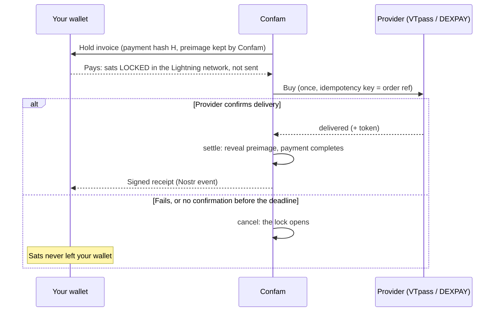
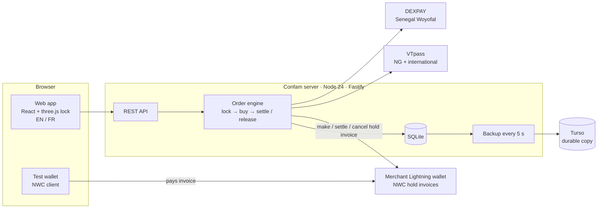

# Confam

**Pay airtime, data and electricity with Bitcoin. If it doesn't arrive, you were never charged.**
*E no land? You no pay. · Pas livré ? Pas payé.*

Live app: **https://confam-qxdh.onrender.com** · English / Français · works on a mid-range phone

Confam pays your bill over Lightning with a **hold invoice**: your sats are *locked*, not sent. Confam
buys the airtime, data or electricity token from the provider, and only when the provider confirms
delivery does the payment complete. If delivery fails or nobody confirms in time, the lock opens and
the sats never left your wallet. No refund to chase, no support ticket, no trust in Confam needed.

---

## Test it in 2 minutes (no account, no real money)

Everything runs on test networks: test sats and provider sandboxes.

1. Open **https://confam-qxdh.onrender.com** on your phone or laptop.
2. Tap **⚡ Connect wallet** (top right) → **Get a free test wallet**. You get 25,000 test sats.
3. Pick your country, then a product (in Nigeria, tap **Use test number** or **Use test meter** to fill
   the sandbox values), and pay with **Pay with my Confam wallet**. Watch the lock:
   *Payment locked → Buying it for you → Provider confirmed delivery → Payment completed*.
4. At the end you get a **signed receipt** that your browser verifies on the spot (Nostr signature).

### Test numbers, by country

✅ delivered, then paid · ⏳ stays pending, then the lock opens at 90 s and the sats come back ·
❌ fails, the lock opens at once and the sats come back

| Country | Airtime | Data | Electricity |
|---|---|---|---|
| 🇳🇬 Nigeria | `08011111111` ✅ · `201000000000` ⏳ · any other number ❌ | same numbers as airtime | Ikeja Electric, prepaid meter `1111111111111` ✅ |
| 🇸🇳 Senegal | any number ✅ · `201000000000` ⏳ | any number ✅ · `201000000000` ⏳ | Woyofal (Senelec): any meter number ✅ (test token) |
| 🇨🇮 Côte d'Ivoire · 🇬🇭 Ghana · 🇲🇱 Mali · 🇧🇫 Burkina Faso · 🇧🇯 Benin · 🇹🇬 Togo · 🇬🇳 Guinea · 🇺🇬 Uganda · 🇿🇦 South Africa · 🇿🇲 Zambia · 🇲🇼 Malawi | any number ✅ · `201000000000` ⏳ | any number ✅ · `201000000000` ⏳ | not offered |
| 🇰🇪 Kenya · 🇨🇲 Cameroon · 🇹🇿 Tanzania · 🇷🇼 Rwanda · 🇪🇹 Ethiopia · 🇲🇿 Mozambique | any number ✅ · `201000000000` ⏳ | not offered (the provider sells no bundles there) | not offered |

These are the providers' sandbox rules: VTpass (`08011111111` succeeds and `201000000000` stays
pending; other Nigerian numbers fail; international numbers succeed) and DEXPAY (any Woyofal meter
returns a test token). No real airtime, data or token is delivered in test mode.

---

## What it covers

| Service | Countries | Provider |
|---|---|---|
| Airtime | 19: Senegal, Nigeria, Côte d'Ivoire, Ghana, Kenya, Cameroon, Mali, Burkina Faso, Benin, Togo, Guinea, Uganda, Tanzania, Rwanda, South Africa, Zambia, Ethiopia, Malawi, Mozambique | VTpass (international airtime API) |
| Data bundles | 13: Senegal, Nigeria, Côte d'Ivoire, Ghana, Mali, Burkina Faso, Benin, Togo, Guinea, Uganda, South Africa, Zambia, Malawi (where the provider sells bundles) | VTpass |
| Electricity | 🇳🇬 Nigeria (12 distribution companies), 🇸🇳 Senegal (Senelec **Woyofal** prepaid) | VTpass, **DEXPAY** (Dakar) |

Networks and price ranges per country come from the provider's live catalogue, in local currency
(e.g. Senegal Orange 100 to 73,811 XOF). Prices in sats come from what the provider actually charges,
so the locked amount always covers the purchase.

---

## Who it's for

**Primary user: someone in Nigeria or Senegal who holds sats and tops up a phone or a prepaid meter
several times a week.** A freelancer paid in Bitcoin, a student saving in it, a family keeping the
Woyofal meter running.

| | Today | With Confam |
|---|---|---|
| Airtime / data | Sell sats to someone on a P2P desk, wait for the naira transfer, then buy airtime in a bank app | Pay the invoice from a Lightning wallet; the top-up lands in about 20 seconds |
| Electricity token | Buy the token; if the vendor takes the money and no token comes, chase a refund for days ("debited but not credited") | The sats stay locked until the token exists; no token, the lock opens by itself |
| When it fails | A support ticket, a screenshot, a wait | Nothing to chase: the payment never completed |

## Reach

- **Ceiling (measured):** 200.3 million active mobile subscriptions in Nigeria in September 2026
  ([NCC industry statistics](https://ncc.gov.ng/market-data-reports/industry-statistics)), and 1.63 million
  Woyofal prepaid customers in Senegal (Senelec's count at 31 August 2023, reported by *Le Soleil*).
- **Bitcoin users there (measured):** Nigeria ranks 6th in the
  [Chainalysis 2025 Global Crypto Adoption Index](https://www.chainalysis.com/blog/2025-global-crypto-adoption-index/);
  Sub-Saharan Africa's on-chain value grew 52% to $205B
  ([Chainalysis](https://www.chainalysis.com/blog/subsaharan-africa-crypto-adoption-2025/)).
- **Our target for the first three months live (an assumption we will measure, not a result):**
  500 weekly payers making about 2 top-ups each, so roughly **1,000 orders a week**, starting with
  Bitcoin communities in Lagos and Dakar, then 18 more countries for airtime the provider already covers.

---

## Constraints

- **It runs in test mode.** Payments use test sats from a Lightning test wallet
  (`faucet.nwc.dev`) and the providers' sandboxes (VTpass, DEXPAY). The API calls, hold invoices,
  delivery checks and signed receipts are the same ones that would run with real money, but **no real
  airtime, data or electricity token reaches a phone**, and a real Lightning wallet cannot pay the
  test invoices (the test wallet is not a node on the public Lightning network).
- **Sandbox outcomes are set by the providers.** VTpass: for Nigerian numbers only `08011111111`
  succeeds and `201000000000` stays pending; international numbers succeed. DEXPAY accepts any
  Woyofal meter and returns a test token.
- **Going live is configuration, not code:** a live VTpass account with API access and a funded naira
  wallet, a mainnet Lightning node that issues hold invoices over Nostr Wallet Connect (Alby Hub
  implements `make_hold_invoice`, `settle_hold_invoice` and `cancel_hold_invoice`), and DEXPAY
  production approval for Senegal electricity.
- **Designed for 3G and mid-range phones:** about 90 KB of JavaScript on first load (gzipped); the 3D
  lock loads after the page and falls back to a still image on 2G, data-saver or low-memory phones.
- **Every payment waits for the provider:** a purchase settles only on the provider's confirmation and
  is released if none arrives within 90 seconds.

---

## Metrics we track (live)

**https://confam-qxdh.onrender.com/api/stats?days=7** computes these from the order database on every
request (counts only: no phone numbers, meters or payment details):

| Metric | Why it matters |
|---|---|
| `chargedWithoutDelivery` | The guarantee itself. Completed without a confirmed delivery. Must always be **0**. |
| `deliveryRate` | Completed ÷ payments locked: how often the provider actually delivers. |
| `medianSecondsToDelivery` | From "sats locked" to "provider confirmed": the wait the customer feels. |
| `released` (by reason) | Failed, unconfirmed at the deadline, wrong amount, lock lost: which provider problems to fix first. |
| `deliveredAfterRelease` | Delivered after the lock opened, so the customer got it free and Confam absorbed the cost. |
| `byCountry`, `byCategory` | Where demand is, to decide which providers and countries come next. |

Alongside these, the server logs an `alert` when a failure is about Confam's own provider account (low
float, rejected keys, product not whitelisted) rather than the customer's order.

## Next iteration

1. **Real money:** an Alby Hub node issuing hold invoices over NWC, a funded live VTpass account and
   DEXPAY production approval (configuration only, see Constraints), plus an alert when provider float
   drops below a day of orders.
2. **More bills where people already pay them:** TV (DStv, GOtv, StarTimes) and internet bundles through
   the same VTpass API, and Senegal's Senelec postpaid electricity and SenEau water bills, which DEXPAY
   already lists (`SENELEC_SN_BILL`, `SENEAU_SN_BILL`).
3. **"Keep my meter topped up":** a recurring order paid from a budget the customer sets in their wallet
   (NWC budgets), still settled only after each token is delivered.
4. **Agents:** a reseller mode so a roadside airtime vendor can accept sats for a top-up with the same
   delivered-or-released guarantee.

---

## How the guarantee works



The rules the engine enforces (and the tests check):

- **Buy at most once per order.** The provider call carries the order reference as its idempotency
  key (DEXPAY rejects a repeat with `IDEMPOTENT_REPLAY`; VTpass requests use a unique request id).
- **Settle only on a confirmed delivery.** Anything unclear is *pending*, never *delivered*.
- **Release on failure or at the deadline.** A pending purchase that is never confirmed releases the
  lock at `VEND_DEADLINE_SEC` (90 s); a confirmation that arrives later is recorded for reconciliation.
- **Lost replies are recovered, never guessed.** If the provider's reply is lost, Confam finds the
  purchase again by its own reference (VTpass requery; DEXPAY tag in `customData`) before deciding.
- **Receipts are verifiable.** Every completed order produces a Nostr-signed receipt (kind 30078)
  naming the product, amount, payment hash and provider reference; the page verifies it in the browser.

---

## Architecture



- **Lightning:** hold invoices over Nostr Wallet Connect (`make_hold_invoice`, `settle_hold_invoice`,
  `cancel_hold_invoice`), or LND REST with an invoice-only macaroon. The merchant wallet is never
  given permission to send funds.
- **Durability:** the server keeps orders in SQLite and copies changes to Turso every 5 seconds. A
  fresh disk is restored from the copy before the engine starts, so locked payments resume.
- **Uptime:** `/api/health?deep=1` also checks that the merchant Lightning wallet answers; an uptime
  pinger hits it every 10 minutes (which also keeps the free host awake).

---

## Threat model (what can go wrong, and what happens)

| Risk | What Confam does |
|---|---|
| Provider takes the money but never delivers | Confam never settles: the hold invoice is cancelled at the deadline. |
| Provider delivers after the deadline | Recorded as delivered-after-release for reconciliation; the customer was not charged. |
| Confam crashes mid-order | Orders (including preimages) are restored from the durable copy; the engine resumes. If never settled, the hold invoice expires and the sats return to the payer. |
| Double purchase on retry | Provider calls carry an idempotency key; the engine calls purchase at most once per order. |
| Server key or provider keys leak | Keys live only in environment variables, never in the repo or the browser. The Lightning wallet connection cannot pay out. |
| Fake receipts | Receipts are Nostr events signed by Confam's key; the browser checks the signature. |
| Personal data | Phone and meter numbers are masked in every API response and in logs (redacted). |
| Abuse | Rate limits on order creation and lookups; per-order caps in sats and in local currency. |

---

## Run it locally

Requirements: Node 24.

```bash
git clone https://github.com/egbujor-emmanuel/confam && cd confam
npm run setup        # installs, creates .env, generates keys and a test merchant wallet
# add sandbox keys to .env: VTpass (sandbox.vtpass.com) and DEXPAY (portal.dexpay.africa)
npm start            # http://localhost:8787
```

Provider sandbox setup, learned the hard way:

- **VTpass sandbox:** in *API Keys*, set **API Authentication Type** to **API Keys** (the default
  "Basic" rejects every key with `087 INVALID CREDENTIALS`), then **Whitelist Products** (otherwise
  every purchase fails with `028`).
- **DEXPAY sandbox:** the balance starts at 0 XOF. Create a sandbox checkout session and click
  *Simuler un paiement réussi* on its sandbox page to fund it.

Tests:

```bash
npm test                              # unit + API tests
npm run test:live -w server           # live: real NWC wallets + real Turso (uses .env)
```

## Deploy (free, no time limit)

`render.yaml` deploys a free Render web service (Node 24). Free services sleep after 15 idle
minutes, so an uptime ping (cron-job.org every 10 minutes, plus `.github/workflows/keepalive.yml`
as a backup) keeps it awake; set `TURSO_*` so restarts never lose orders.

## License

MIT
