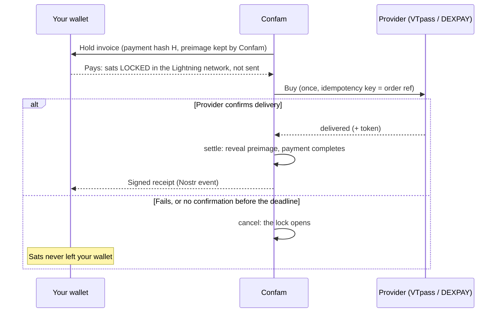
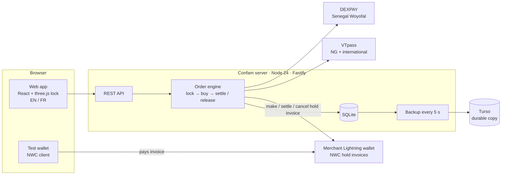

# Confam

**Pay airtime, data and electricity with Bitcoin. If it doesn't arrive, you were never charged.**
*E no land? You no pay. · Pas livré ? Pas payé.*

Live app: **{{LIVE_URL}}** · English / Français · works on a mid-range phone

Confam pays your bill over Lightning with a **hold invoice**: your sats are *locked*, not sent. Confam
buys the airtime, data or electricity token from the provider, and only when the provider confirms
delivery does the payment complete. If delivery fails or nobody confirms in time, the lock opens and
the sats never left your wallet. No refund to chase, no support ticket, no trust in Confam needed.

---

## Test it in 2 minutes (no account, no real money)

Everything runs on test networks: test sats and provider sandboxes.

1. Open **{{LIVE_URL}}** on your phone or laptop.
2. Tap **⚡ Connect wallet** (top right) → **Get a free test wallet**. You get 25,000 test sats.
3. Pick your country, then a product, and pay with **Pay with my Confam wallet**. Watch the lock:
   *Payment locked → Buying it for you → Provider confirmed delivery → Payment completed*.
4. At the end you get a **signed receipt** that your browser verifies on the spot (Nostr signature).

| Try this | Country | What to enter | What happens |
|---|---|---|---|
| Airtime, success | 🇸🇳 Senegal (or any of 19 countries) | Your own number, network **Orange**, 1,000 XOF | Delivered, then paid |
| Electricity token | 🇸🇳 Senegal | Woyofal meter: **any number** (sandbox) | Token on screen, then paid |
| Electricity token | 🇳🇬 Nigeria | Ikeja Electric, prepaid meter **1111111111111** | Token on screen, then paid |
| **Delivery fails** | 🇳🇬 Nigeria | MTN airtime to **08022222222** | *It didn't go through. You were not charged.* |
| **Provider never confirms** | any | Phone **201000000000** | Lock opens at the 90 s deadline, sats back |

Sandbox numbers are VTpass's documented test numbers (`08011111111` succeeds, `201000000000` stays
pending, any other Nigerian number fails). The DEXPAY sandbox accepts any meter and returns a test token.

---

## What it covers

| Service | Countries | Provider |
|---|---|---|
| Airtime | 19: Senegal, Nigeria, Côte d'Ivoire, Ghana, Kenya, Cameroon, Mali, Burkina Faso, Benin, Togo, Guinea, Uganda, Tanzania, Rwanda, South Africa, Zambia, Ethiopia, Malawi, Mozambique | VTpass (international airtime API) |
| Data bundles | Senegal, Nigeria, Côte d'Ivoire, Ghana, Mali, Burkina Faso, Benin, Togo (where the provider sells bundles) | VTpass |
| Electricity | 🇳🇬 Nigeria (12 distribution companies), 🇸🇳 Senegal (Senelec **Woyofal** prepaid) | VTpass, **DEXPAY** (Dakar) |

Networks and price ranges per country come from the provider's live catalogue, in local currency
(e.g. Senegal Orange 100 to 73,811 XOF). Prices in sats come from what the provider actually charges,
so the locked amount always covers the purchase.

---

## How the guarantee works



The rules the engine enforces (and the tests check):

- **Buy at most once per order.** The provider call carries the order reference as its idempotency
  key (DEXPAY rejects a repeat with `IDEMPOTENT_REPLAY`; VTpass requests use a unique request id).
- **Settle only on a confirmed delivery.** Anything unclear is *pending*, never *delivered*.
- **Release on failure or at the deadline.** A pending purchase that is never confirmed releases the
  lock at `VEND_DEADLINE_SEC` (90 s); a confirmation that arrives later is recorded for reconciliation.
- **Lost replies are recovered, never guessed.** If the provider's reply is lost, Confam finds the
  purchase again by its own reference (VTpass requery; DEXPAY tag in `customData`) before deciding.
- **Receipts are verifiable.** Every completed order produces a Nostr-signed receipt (kind 30078)
  naming the product, amount, payment hash and provider reference; the page verifies it in the browser.

---

## Architecture



- **Lightning:** hold invoices over Nostr Wallet Connect (`make_hold_invoice`, `settle_hold_invoice`,
  `cancel_hold_invoice`), or LND REST with an invoice-only macaroon. The merchant wallet is never
  given permission to send funds.
- **Durability:** the server keeps orders in SQLite and copies changes to Turso every 5 seconds. A
  fresh disk is restored from the copy before the engine starts, so locked payments resume.
- **Uptime:** `/api/health?deep=1` also checks that the merchant Lightning wallet answers; an uptime
  pinger hits it every 10 minutes (which also keeps the free host awake).

---

## Threat model (what can go wrong, and what happens)

| Risk | What Confam does |
|---|---|
| Provider takes the money but never delivers | Confam never settles: the hold invoice is cancelled at the deadline. |
| Provider delivers after the deadline | Recorded as delivered-after-release for reconciliation; the customer was not charged. |
| Confam crashes mid-order | Orders (including preimages) are restored from the durable copy; the engine resumes. If never settled, the hold invoice expires and the sats return to the payer. |
| Double purchase on retry | Provider calls carry an idempotency key; the engine calls purchase at most once per order. |
| Server key or provider keys leak | Keys live only in environment variables, never in the repo or the browser. The Lightning wallet connection cannot pay out. |
| Fake receipts | Receipts are Nostr events signed by Confam's key; the browser checks the signature. |
| Personal data | Phone and meter numbers are masked in every API response and in logs (redacted). |
| Abuse | Rate limits on order creation and lookups; per-order caps in sats and in local currency. |

---

## Run it locally

Requirements: Node 24.

```bash
git clone https://github.com/egbujor-emmanuel/confam && cd confam
npm run setup        # installs, creates .env, generates keys and a test merchant wallet
# add sandbox keys to .env: VTpass (sandbox.vtpass.com) and DEXPAY (portal.dexpay.africa)
npm start            # http://localhost:8787
```

Provider sandbox setup, learned the hard way:

- **VTpass sandbox:** in *API Keys*, set **API Authentication Type** to **API Keys** (the default
  "Basic" rejects every key with `087 INVALID CREDENTIALS`), then **Whitelist Products** (otherwise
  every purchase fails with `028`).
- **DEXPAY sandbox:** the balance starts at 0 XOF. Create a sandbox checkout session and click
  *Simuler un paiement réussi* on its sandbox page to fund it.

Tests:

```bash
npm test                              # unit + API tests
npm run test:live -w server           # live: real NWC wallets + real Turso (uses .env)
```

## Deploy (free, no time limit)

`render.yaml` deploys a free Render web service (Node 24). Free services sleep after 15 idle
minutes, so an uptime ping (cron-job.org every 10 minutes, plus `.github/workflows/keepalive.yml`
as a backup) keeps it awake; set `TURSO_*` so restarts never lose orders.

## License

MIT
